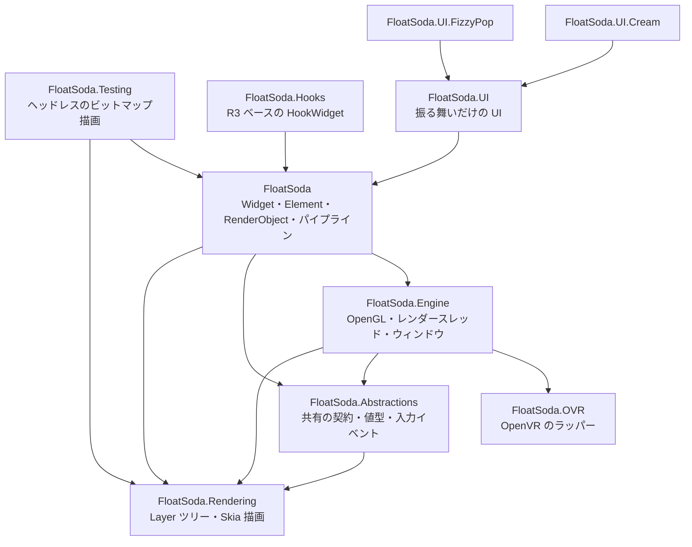
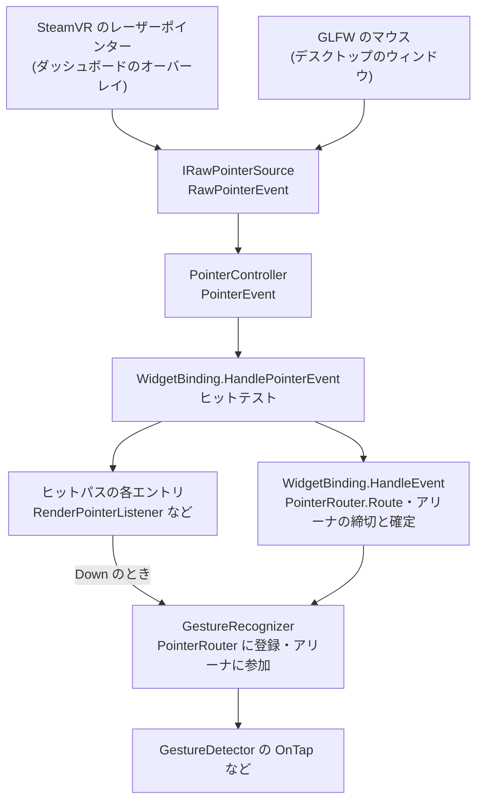

# 全体の仕組みと理由

FloatSoda 全体がいまどう動き、なぜその設計にしたかを、層をまたぐ範囲で説明します。アセンブリの分け方、1フレームの流れ、スレッドの分担、SteamVR のポインターが Widget のジェスチャになるまでの流れ、API とローカライズの判断原則を扱います。各層の内部は、その層の「仕組みと理由」のページで詳しく説明します。

## 実装状況

RenderObject ツリーと Layer ツリーは実装済みです。Widget / Element ツリーは、`StatelessWidget`、`StatefulWidget`、`InheritedWidget` と、`BuildOwner` による差分ビルドまで動きます。ポインター入力は、ダッシュボードのオーバーレイとデスクトップのウィンドウで動きます。

利用者から観測できる未実装は、次のとおりです。

- `WorldSpaceWindow` と `DeviceTrackedWindow` にはポインター入力が届かず、`GestureDetector` のコールバックが呼ばれない(追跡: [#182](https://github.com/sumx21t-3310/FloatSoda/issues/182))
- スクロールする Widget(`ListView`、`GridView`、`SingleChildScrollView`)は使えない(追跡: [#69](https://github.com/sumx21t-3310/FloatSoda/issues/69))
- `FloatSoda.UI` と、その上のデザインシステム(`FloatSoda.UI.Cream`、`FloatSoda.UI.FizzyPop`)は NuGet パッケージにならず、`ButtonBase` は入力に接続されていない(追跡: [#126](https://github.com/sumx21t-3310/FloatSoda/issues/126)、[#102](https://github.com/sumx21t-3310/FloatSoda/issues/102))
- `FloatSoda.Hooks` はフレームワークのビルドループに統合されていない(追跡: ※要確認)

## 責務と境界: アセンブリの依存

FloatSoda は、描画、エンジン、OpenVR、フレームワーク、UI の順に積み上げたアセンブリで構成します。下の図の矢印は「参照する側 → 参照される側」です。依存の一次情報は、各プロジェクトの `.csproj` にある `ProjectReference` です。

境界は次のように分けています。

- `FloatSoda.Rendering` と `FloatSoda.OVR` は、ほかの FloatSoda のアセンブリを参照しない
- `FloatSoda.Engine` は、OpenGL のコンテキスト、ウィンドウ、レンダースレッドを持ち、Widget を知らない
- `FloatSoda` は、Widget から Layer までの3つのツリーと、それを毎フレーム回す `FloatSodaApp` を持つ。OpenVR には `FloatSoda.Engine` を通して触れる
- `FloatSoda.UI` から上は `FloatSoda` の上に積む。層の分け方は [UILayering](../UILayering.md) にある

アセンブリの一覧は `src/` のディレクトリと `FloatSoda.slnx` で確かめます。

## 処理の流れ: 1フレーム

メインスレッドが1フレームごとに入力を処理し、ツリーを更新して Layer ツリーを作り、その複製をレンダースレッドへ渡します。レンダースレッドは受け取った Layer ツリーを OpenGL のテクスチャに描き、OpenVR のオーバーレイへ渡します。

メインスレッドのループ(`FloatSodaApp` のメインループ)は、1周で次の順に進みます。

1. ほかのスレッドから投入されたタスクを実行する
2. SteamVR のシステムイベント(`VREvent_Quit` など)と、アクション入力を処理する
3. ウィンドウごとに `WidgetBinding.BeginFrame` を呼ぶ。中では、ポインターイベントの処理、フレームコールバックの実行、`DrawFrame` の順に進む
4. `FramePacer` で次のフレームまで待つ

`DrawFrame` は、dirty な Element を `BuildOwner.BuildScope()` で作り直します。描き直しが要るときだけ、続けて `RenderPipeline.FlushLayout()` と `FlushPaint()` を実行します。最後に、できた Layer ツリーを `Clone()` してレンダースレッドへ渡します。

レンダースレッドは、投入されたタスクを順に実行してから、GLFW のイベントを処理します。描画のタスクでは、ウィンドウの `Present` が Layer ツリーを Skia で GL テクスチャへ描き、オーバーレイならそのテクスチャを OpenVR へ渡します。

各段階の内部は、次のページで説明します。

| 段階 | 説明するページ |
|---|---|
| Build | [三つのツリーの仕組みと理由](Trees.md) |
| Layout と Paint | [三つのツリーの仕組みと理由](Trees.md)、[コアの仕組みと理由](Core.md) |
| Layer ツリーの描画 | [描画の仕組みと理由](Rendering.md) |
| テクスチャの転送とレンダースレッド | [プラットフォームの仕組みと理由](Platform.md) |

## 所有権とスレッド

ツリーはメインスレッドが持ち、OpenGL のコンテキストはレンダースレッドが持ちます。2つのスレッドは同じオブジェクトを触らず、キューに積んだタスクでだけやりとりします。

| スレッド | 持つもの | ほかのスレッドとのやりとり |
|---|---|---|
| メインスレッド(STA) | Widget / Element / RenderObject ツリー、`RenderPipeline`、ポインター入力の状態、OpenVR のイベントの受け取り | `RenderPostTaskRunner.PostTask` と `PostRender` で、レンダースレッドへタスクを積む |
| レンダースレッド | OpenGL のコンテキスト、GLFW、`GLView`、`Renderer`、ウィンドウ | `ConcurrentQueue<Action>` に積まれたタスクを、フレームごとに取り出して実行する |
| スレッドプール | `ImageProvider` による画像の読み込みとデコード | 完了後の再ビルドは、`BuildOwner` のスケジューラを通してメインスレッドで実行する |
| I/O スレッド | 投入順に1件ずつ実行する必要がある処理(利用者のコード向け) | `IOTaskRunner` に投入する。FloatSoda 自身の画像とフォントの読み込みには使わない |

ウィンドウの作成も、`PostTask` を通してレンダースレッドで実行します。そのため、メインスレッドから見るとウィンドウは非同期にでき、ポインター入力はウィンドウができたフレームから配線されます。

Layer ツリーは `Clone()` してから渡します。メインスレッドが次のフレームで元のツリーを書き換えても、レンダースレッドが描いている複製には影響しません。複製したあとに可変オブジェクトを共有しないことは、[REVIEW.md の「Layer」](../../../REVIEW.md#layer)の不変条件です。

## 処理の流れ: 入力

SteamVR のレーザーポインターは、生のイベント、ポインターイベント、ヒットテスト、ジェスチャ認識の順に変換されて、Widget のコールバックに届きます。前半(生のイベントまで)はプラットフォームの層、後半(ポインターイベントから)はフレームワークの層が受け持ちます。

### 生のイベント: ウィンドウの種類ごとの入力源

ウィンドウは、入力源として `IRawPointerSource` を1つ持ちます。入力源は、入る・出る・動く・押す・離すという観測した事実だけを `RawPointerEvent` で知らせます。

- ダッシュボードのオーバーレイでは、`OverlayWindow` がオーバーレイの入力方式をマウスにし、マウスのスケールをテクスチャのピクセルサイズに合わせる。SteamVR はレーザーポインターをマウスのイベントとして送り、`OverlayMouseRawPointerSource` がそれを `RawPointerEvent` に変える。座標はテクスチャのピクセル座標で、原点は左上として届く
- デスクトップのウィンドウでは、`GLFWRawPointerSource` が GLFW のマウスのコールバックを `RawPointerEvent` に変える
- それ以外のオーバーレイ(`WorldSpaceWindow`、`DeviceTrackedWindow`)では、入力源が `null` で、ポインター入力は届かない

`FloatSoda.OVR` には、コントローラーのレイとオーバーレイの交点を毎フレーム計算する `ControllerPointerSystem` があります。SteamVR にオーバーレイの入力を任せないため、VRChat の AFK 判定を避けられます。ただし、`IRawPointerSource` にはまだ接続していません(追跡: [#182](https://github.com/sumx21t-3310/FloatSoda/issues/182))。

### ポインターイベント: 状態機械で意味を付ける

`PointerController` は、生のイベントを `PointerEvent` に変えます。ポインターが入ってきたときに `Add` を作って `PointerId` を振り、押下中に出ていったときは `Cancel` と `Remove` を作ります。ボタンは主ボタン(VR のトリガーを含む)だけを `Down` / `Up` にします。

入力源は、元のイベントを受け取ったスレッドで `RawPointerEvent` を発火します。ダッシュボードではメインスレッド、デスクトップでは GLFW を回すレンダースレッドです。`PointerController` は受け取った生のイベントをキューに積むだけで、変換と通知は `Flush()` を呼んだメインスレッドで行います。`Flush()` は `BeginFrame` の最初に1回呼ばれるため、入力はフレームごとにまとめて処理されます。

### ヒットテスト: Down の位置で当たった RenderObject を決める

`WidgetBinding` は、`Down` を受けると、その位置で `RenderView` からヒットテストをします。ヒットテストは、子を先に調べてから自分を足すため、ヒットパスは末端に近い RenderObject から並びます。パスの最後には `RenderView` と `WidgetBinding` 自身が入ります。

ヒットパスはポインターごとに保存します。`Move` と `Up` は、そのときの位置ではなく、`Down` のときのパスへ届けます。押したまま Widget の外へ動かしても、押し始めた Widget がイベントを受け取り続けます。

ホバーは別に追いかけます。`Add`、`Down`、`Move`、`Up` のたびに、その位置でヒットテストをして前回のパスと比べ、外れた `RenderPointerListener` に `Exit`、新しく入ったものに `Enter` を送ります。レイアウトが変わったフレームでも、ポインターの位置で同じ比較をし直します。

### ジェスチャ: アリーナで勝者を1つに決める

`GestureDetector` の中の `RenderPointerListener` が `Down` を受け取ると、登録されたジェスチャ認識器(`TapGestureRecognizer`、`PanGestureRecognizer`)の `AddPointer` を呼びます。認識器は、`PointerRouter` にそのポインターの後続イベントの購読を登録し、`GestureArenaManager` のアリーナに参加します。

ヒットパスの最後にいる `WidgetBinding` は、`PointerRouter.Route` で購読した認識器へイベントを届け、続けてアリーナを進めます。

- `Down` — アリーナの受付を締め切る。参加者が1つなら、その認識器が勝つ
- `Up` — まだ勝者が決まっていなければ、最初に参加した認識器を勝者にする
- `Cancel` — アリーナを取り消し、残っている認識器を全部負けにする

勝った認識器が、`OnTap` のような Widget のコールバックを呼びます。ジェスチャとヒットテストの内部は [三つのツリーの仕組みと理由](Trees.md) で、SteamVR とオーバーレイの入力は [プラットフォームの仕組みと理由](Platform.md) で説明します。

## なぜそう設計したか

### Flutter の語彙と、C# の表現手段

FloatSoda は、Flutter の三つのツリーと、ウィジェットやレイアウトの語彙をそのまま使います。利用者とコード生成 AI が Flutter の知識で書いたコードを、そのまま正しいコードにするためです。一方で、その語彙を表す手段は C# に従います。Dart の言語の制約から生まれた `addListener` のような形は写さず、`event`、`init`、`required`、`record struct` で同じ意図を表します。

この原則から、さらに3つの判断が出てきます。いずれも [APIDesign の「1. 基本設計哲学」](../APIDesign.md#1-基本設計哲学)が一次情報です。

- .NET が同等の機構を標準で持っていれば、自前で作らずにそれを使う。「同等」は API の形ではなく、満たす契約が一致するかで判定する
- Flutter 由来の Widget と RenderObject は、Flutter と同じ observable behavior にする。「実装しやすい」「こちらのほうが自然」は差異の理由にならない
- 対象ユーザーに需要がなく、ランタイムに受け皿もない Flutter の API(Semantics など)は移植しない

### 日本語を既定の言語にする

例外メッセージ、XML ドキュメントコメント、`docs/` は、日本語を既定(ニュートラル)の言語にしています。[TargetUsers](../../TargetUsers.md) の3つのペルソナは、いずれも日本語話者を第一に想定しているためです。言語が揃うと、利用者に代わってコードを書く LLM が、エラーの説明も日本語で返します。

国際展開を優先するなら英語を既定にするのが一般的ですが、FloatSoda は主な利用者と Booth での流通を優先しました。その結果、日本語でも英語でもない OS では日本語のメッセージが出ます。この判断を変えるときは、Issue で議論します。仕組みと手順は [Localization](../Localization.md) にあります。

## Flutter との対応

3つのツリーと、入力の部品は、Flutter と同じ分け方をしています。

| FloatSoda | Flutter |
|---|---|
| `WidgetBinding.HandleEvent` でのルーティングとアリーナの進行 | `GestureBinding.handleEvent` |
| `PointerRouter` | `PointerRouter` |
| `GestureArenaManager` | `GestureArenaManager` |

フレームの流れには、Flutter との確認済みの差異があります。ポインター入力はフレームの先頭でまとめて処理され、Flutter のようにフレームと独立には配送されません。フレームの段階には、Flutter の post-frame コールバックなどがありません。どちらも [`known-divergences.md`](../../../.agents/skills/floatsoda-device-test-gen/references/known-divergences.md) の台帳に記録されています。

## テストでの駆動

フレームの流れと入力の流れは、SteamVR も実時間もなしで動かせます。

- `WidgetBinding` を `RenderView` だけで作り、ルートの Widget をつなぐと、ウィンドウなしでビルドとレイアウトを流せる
- 入力は、テスト用の `IRawPointerSource` から `RawPointerEvent` を発火し、`PointerController.Flush()` で `WidgetBinding` へ流す。例は `tests/FloatSoda.Test/Core/PointerInputIntegrationTest.cs` にある
- 描画結果は、`FloatSoda.Testing` の `WidgetBitmapRenderer` と `RenderObjectBitmapRenderer` でビットマップにして確かめる

SteamVR のイベントの届き方、コントローラーの座標、レンダースレッドの GL コンテキストは、実機でしか確かめられません。手順は [作業の手順](../how-to/Home.md#実機で確かめる) にあります。

## 関連

- [守ること](../reference/Home.md) — 層をまたいで維持する条件
- [Architecture](../Architecture.md) — アセンブリ構成、ツリー構造、レンダリングライフサイクル、スレッドモデル(再編前のページ)
- [APIDesign](../APIDesign.md) — API 設計の規約と判断原則
- [Localization](../Localization.md) — ローカライズの仕組みと手順
- [FloatSoda を変える](../Home.md) — 部分ごとの「仕組みと理由」
