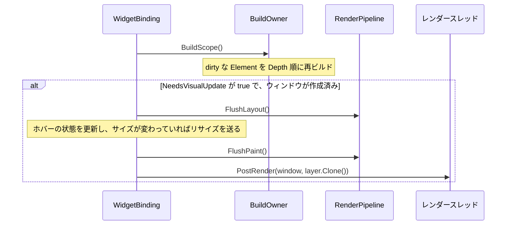

# フレームワーク(コア): 仕組みと理由

コアの層は、アプリの起動から、1フレーム分の処理を順番どおりに呼ぶところまでを受け持ちます。中心になるのは、ウィンドウごとにフレームを回す `WidgetBinding` と、dirty な RenderObject を消化する `RenderPipeline` です。このページでは、起動の流れ、1フレームの流れ、それぞれの持ち主と寿命、設計の理由を説明します。Widget・Element・RenderObject の中身は [三つのツリーの Explanation](../trees/Explanation.md) にあります。

## 実装状況

起動と停止、ウィンドウごとのフレーム処理、変更のないフレームを飛ばす仕組みは動いています。Flutter と比べて足りないものと、移行中のものは次のとおりです。

| 対象 | 現状 |
|---|---|
| フレームのフェーズ | Flutter の post-frame callback に当たる段がない(台帳の #6) |
| ポインタ入力の配送 | フレームの先頭でまとめて配る(台帳の #7) |
| `await` の続き | メインスレッドへ戻らない(追跡: [#281](https://github.com/sumx21t-3310/FloatSoda/issues/281)) |
| 公開 API の Skia 型 | `WidgetBinding.Size` の `SKSizeI` などが残っている(追跡: [#131](https://github.com/sumx21t-3310/FloatSoda/issues/131)) |

台帳は、Flutter との差異を記録した [`known-divergences.md`](../../../../.agents/skills/floatsoda-device-test-gen/references/known-divergences.md) です。

## 責務と境界

コアは「いつ、どの順で呼ぶか」を決め、「呼ばれた先で何をするか」はほかの層に任せます。

| コアが担う | コアが担わない(担う層) |
|---|---|
| Generic Host への登録、アプリの起動と停止 | OpenVR の初期化とオーバーレイの作成(プラットフォーム) |
| ウィンドウごとのフレーム処理の順序 | Element の再ビルドの中身(三つのツリー) |
| dirty な RenderObject を `Depth` 順に消化すること | 個々の RenderObject のレイアウトと描画(三つのツリー) |
| ポインタイベントをヒットテストへ渡す起点 | ヒットテストの判定とジェスチャ認識(三つのツリー) |
| ジオメトリの値型(`Geometrics`)と描画の設定値(`Painting`) | Layer の描画と GL テクスチャへの転送(描画、プラットフォーム) |

## 関係するコンポーネント

| 型 | ソース | 役割 |
|---|---|---|
| `AddFloatSoda` | `src/FloatSoda/FloatSodaServiceCollectionExtensions.cs` | `FloatSodaApp` と `FloatSodaHostedService` を DI コンテナへ登録する |
| `FloatSodaHostedService` | `src/FloatSoda/FloatSodaHostedService.cs` | メインスレッドを作り、その上で `FloatSodaApp.Run` を呼ぶ |
| `FloatSodaApp` | `src/FloatSoda/FloatSodaApp.cs` | メインループを回し、ウィンドウごとの `WidgetBinding` を持つ |
| `WidgetBinding` | `src/FloatSoda/Core/WidgetBinding.cs` | 1つのウィンドウについて、入力・フレームコールバック・ビルド・レイアウト・描画を順に呼ぶ |
| `RenderPipeline` | `src/FloatSoda/Core/RenderPipeline.cs` | dirty な RenderObject のリストを持ち、`FlushLayout` と `FlushPaint` で消化する |
| `RenderPostTaskRunner` | `src/FloatSoda.Engine/TaskRunner.cs` | レンダースレッド。ウィンドウの作成と Layer ツリーの描画を受け取る |

## 処理の流れ

### 起動

アプリのコードは、Generic Host を組み立ててから FloatSoda を取り出します。流れは次のとおりです(実例は `samples/FloatSoda.Samples.Image/Program.cs`)。

1. `builder.Services.AddFloatSoda(options)` が、`FloatSodaApp` をシングルトンとして、`FloatSodaHostedService` をホスト型サービスとして登録する(`TargetFrameRate` が 0 以下なら `ArgumentOutOfRangeException` を投げる)
2. アプリが `host.Services.GetRequiredService<FloatSodaApp>()` で取り出し、`CreateWindow` でウィンドウを作る処理をキューに積む
3. `host.RunAsync()` から呼ばれた `FloatSodaHostedService.StartAsync` が、`FloatSodaMainThread` という名前のスレッドを作る(Windows では STA に設定する)
4. そのスレッドで `FloatSodaApp.Run` が OpenVR を初期化してメインループに入り、`StartAsync` は初期化が終わるまで待つ
5. メインループの最初の周回で、キューに積まれたウィンドウの作成(`WidgetBinding` の作成、`EnsureInitialized`、`AttachRootWidget`)が実行される

`CreateWindow` を呼んだ時点では、ウィンドウはまだ作られません。

OpenVR の初期化のうち、アプリの識別(`Identify`)とアクション入力の初期化は、失敗しても起動を続けます。コードのコメントに書かれた理由は、マニフェストに登録していない AppKey でも起動できるようにするため、入力が使えなくても表示は続けられるため、の2つです。

### 停止

メインループは、キャンセルトークンが取り消されるまで回ります。取り消しのきっかけは次の3つです。

- SteamVR から `VREvent_Quit` か `VREvent_ProcessQuit` が届く
- Host が停止する(`StopAsync` が `RequestStop` を呼ぶ)
- メインループの中で例外が出る(ログに書いてからループを抜ける)

ループを抜けると、`FloatSodaApp.Dispose` がレンダースレッドと I/O スレッドを止め、OpenVR を解放します。最後に `FloatSodaHostedService` が `StopApplication` を呼び、Host 全体が止まります。

### 1フレーム

メインループの1周は、次の順に進みます。

1. キューに積まれた処理(ウィンドウの作成、ホットリロードの `Reassemble`)をすべて実行する
2. SteamVR のイベントを取り出し(`PollEvents`)、アクション入力を更新する
3. 経過時間を1回だけ取り、すべてのウィンドウの `WidgetBinding.BeginFrame(elapsed)` に同じ値を渡す
4. `FramePacer.WaitForNextFrame` で次のフレームまで待つ

`BeginFrame` の中身は、次の3段です。

1. **入力** — ウィンドウの入力源からポインタイベントを取り出し、ヒットテストして配送する(`FlushPointerEvents`)
2. **フレームコールバック** — `ScheduleFrameCallback` で登録された処理を呼ぶ段で、`WidgetTicker` もここで時刻を受け取る([アニメーションの Explanation](../animation/Explanation.md))
3. **描画** — `DrawFrame` を呼ぶ

`DrawFrame` は、ビルドを毎フレーム確かめ、レイアウトから先は必要なときだけ実行します。

`NeedsVisualUpdate` は、次のどちらかで `true` になります。どちらも `WidgetBinding.EnsureVisualUpdate` を呼びます。

- `BuildOwner` が Element の再ビルドを予約したとき
- RenderObject が `MarkNeedsLayout` か `MarkNeedsPaint` を呼び、`RenderPipeline.RequestVisualUpdate` が呼ばれたとき

そのため、Widget にも RenderObject にも変更がないフレームでは、レイアウト・描画・Layer の受け渡しがすべて飛ばされます。

### RenderPipeline が dirty なノードを消化する順序

`RenderPipeline` は、`NodesNeedingLayout` と `NodesNeedingPaint` の2つのリストを持ちます。RenderObject は、`MarkNeedsLayout` と `MarkNeedsPaint` で、最も近い境界のノードをこのリストへ登録します(伝播の仕組みは [三つのツリーの Explanation](../trees/Explanation.md))。

- `FlushLayout` は、リストを `Depth` の小さい順(親が先)に `LayoutWithoutResize` し、処理中に登録されたノードも、リストが空になるまで同じ呼び出しの中で処理する
- `FlushPaint` は、開始時点のリストだけを `Depth` 順に `PaintingContext.RepaintCompositedChild` で描き直し、処理中に登録されたノードは次の `FlushPaint` に回す
- どちらも、もう dirty でないノードと、`Owner` がこのパイプラインでないノード(ツリーから外れたノード)を飛ばす

最初のフレームでは、`RenderView.PrepareInitialFrame` がルートを両方のリストに登録し、ツリー全体をレイアウトして描画します。

## 所有権・ライフサイクル

| もの | 持ち主 | 作られるとき | 捨てられるとき |
|---|---|---|---|
| `FloatSodaApp` | DI コンテナ(シングルトン) | 最初に解決されたとき | `Run` を抜けたとき(`Dispose`) |
| `WidgetBinding` | `FloatSodaApp`(`Title` をキーにした辞書) | メインループが `CreateWindow` の処理を実行したとき | アプリの終了まで残る。ウィンドウを取り除く API はない |
| `BuildOwner` | `WidgetBinding`(1つのウィンドウに1つ) | `WidgetBinding` のコンストラクタ | `WidgetBinding` と同じ |
| `RenderPipeline` と `RenderView` | `WidgetBinding` | `EnsureInitialized` | `WidgetBinding` と同じ |
| エンジンのウィンドウ(`IEngineWindow`) | `WidgetBinding` | `EnsureInitialized` がレンダースレッドへ予約した処理の中 | レンダースレッドの停止時 |

エンジンのウィンドウはレンダースレッドで非同期に作られます。そのため、作られるまでのフレームでは、`DrawFrame` がレイアウトから先を実行しません。ポインタの入力源も、ウィンドウが作られたことを観測したフレームから接続されます。

`WidgetBinding` と `RenderPipeline` を触るのは、メインスレッドだけです。例外は `NeedsVisualUpdate` で、バックグラウンドで完了したタスクからも書き込まれるため、フィールドを `volatile` にしています。スレッド全体の分担は [Architecture](../../Architecture.md) の「スレッドモデル」にあります。

## なぜそう設計したか

コードと既存の文書に理由が書かれている判断は、次のとおりです。

| 判断 | 理由 | 出典 |
|---|---|---|
| 変更がないフレームでは、レイアウトと描画を飛ばす | 変わった部分だけを処理するため。Flutter と同じ戦略 | [BuildPipeline](../../BuildPipeline.md) |
| 経過時間を1フレームに1回だけ取り、全ウィンドウに同じ値を配る | 同じフレームのすべてのウィンドウに、同一のタイムスタンプを渡すため | `FloatSodaApp.DrawFrame` のコメント |
| 経過時間を、壁時計ではなく `TimeProvider` の単調なタイムスタンプから取る | テストで `FakeTimeProvider` などに差し替えられるようにするため | `FloatSodaApp` のフィールドのコメント |
| Layer ツリーを `Clone` してからレンダースレッドへ渡す | メインスレッドとレンダースレッドが、同じ可変オブジェクトを共有しないようにするため | [REVIEW.md](../../../../REVIEW.md) の「Layer」 |
| アプリの識別とアクション入力の初期化の失敗を、起動の失敗にしない | 表示は続けられるため | `FloatSodaApp.Initialize` のコメント |

次の判断は、理由を書いた一次情報を見つけられませんでした。

- ウィンドウごとに `WidgetBinding` と `BuildOwner` を分けたこと ※要確認
- Generic Host のスレッドとは別にメインスレッドを作り、STA にすること ※要確認

## Flutter との対応

| FloatSoda | Flutter | 違い |
|---|---|---|
| `WidgetBinding` | `WidgetsBinding`、`SchedulerBinding`、`GestureBinding` | 3つの役割を1つのクラスにまとめ、ウィンドウごとに1つ作る |
| `RenderPipeline` | `PipelineOwner` | dirty なノードを `Depth` 順に処理する点は同じ |
| `ScheduleFrameCallback` | `SchedulerBinding.scheduleFrameCallback` | 渡される時刻は、アプリの開始からの経過時間 |
| `BeginFrame` の段 | transient → persistent → post-frame の各フェーズ | post-frame callback などの段がない(台帳の #6) |
| ポインタの配送 | `GestureBinding.handlePointerEvent` がフレームとは別に配る | フレームの先頭でまとめて配る(台帳の #7) |

## テストでの駆動

コアの処理は、OpenVR とレンダースレッドを動かさずにテストできます。

- **フレームコールバック** — レンダースレッドを `Start` しないまま `WidgetBinding` を `EnsureInitialized` すると、ウィンドウを作らずに `BeginFrame(TimeSpan)` へ任意の時刻を渡せる(`tests/FloatSoda.Test/Core/WidgetBindingTest.cs`)
- **ビルドとレイアウト** — `RenderView` と `RenderPipeline` を直接作り、`RenderObjectToWidgetAdapter.AttachToRenderTree` でルートの Widget を接続してから、`BuildScope` と `FlushLayout` を呼ぶ(`tests/FloatSoda.Test/Widgets/PaddingTest.cs`)
- **描画結果** — `FloatSoda.Testing` の `WidgetBitmapRenderer` でビットマップへ描き、画素を確かめる([三つのツリーの HowTo](../trees/HowTo.md))

## 関連

- [コアの Reference](Reference.md) — `RenderPipeline` と値型で守る条件
- [三つのツリーの Explanation](../trees/Explanation.md) — ビルド・レイアウト・描画・ヒットテストの中身
- [アニメーションの Explanation](../animation/Explanation.md) — フレームコールバックと `WidgetTicker`
- [Architecture](../../Architecture.md) — アセンブリ構成とスレッドモデル
