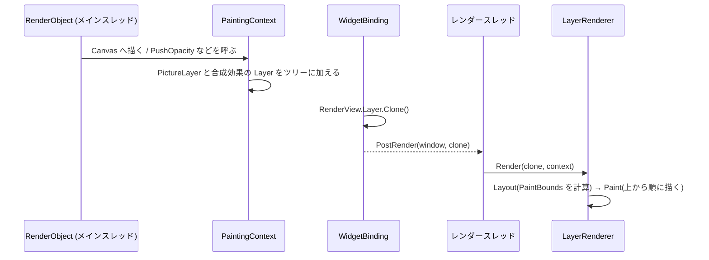

# 描画: 仕組みと理由

描画の層(`FloatSoda.Rendering`)は、RenderObject ツリーの Paint が記録した結果を Layer ツリーとして受け取り、レンダースレッドで Skia のキャンバスへ合成する層です。このページでは、Layer ツリーがどう作られ、どう描かれるかと、メインスレッドが Layer ツリーを Clone してから渡す理由を説明します。変更の前後で守る条件は [描画: 守ること](Reference.md) にあります。

## 実装状況

Layer ツリーの組み立て、Clone、レンダースレッドでの描画は動いています。Flutter の Layer のうち、シェーダーでマスクする Layer(追跡: [#154](https://github.com/sumx21t-3310/FloatSoda/issues/154))と、背景をぼかす Layer(追跡: [#38](https://github.com/sumx21t-3310/FloatSoda/issues/38))はまだありません。いまある Layer の種類は、[`src/FloatSoda.Rendering/Layers/`](../../../src/FloatSoda.Rendering/Layers) のファイルが一次情報です。

## 責務と境界

描画の層が担うのは、Layer の型と、Layer ツリーを1枚のキャンバスへ描く処理だけです。`FloatSoda.Rendering` が参照するのは SkiaSharp だけで、RenderObject、Widget、OpenGL、OpenVR のどれも参照しません([`FloatSoda.Rendering.csproj`](../../../src/FloatSoda.Rendering/FloatSoda.Rendering.csproj))。

| 担うもの | 担わないもの(置き場所) |
|---|---|
| Layer の型と、その Layout・Paint・Clone([`Layers/`](../../../src/FloatSoda.Rendering/Layers)) | Paint の記録と Layer ツリーの組み立て(`FloatSoda` の `PaintingContext`) |
| Layer ツリーを1枚のキャンバスへ描く `LayerRenderer` | 描画先のクリアとフラッシュ、OpenVR へのテクスチャ転送(`FloatSoda.Engine`。[プラットフォーム: 仕組みと理由](../platform/Explanation.md)) |
| CPU 上のビットマップへ描く `LayerBitmapRenderer` と、PNG への保存(`SKBitmapExtensions.Save`) | RenderObject や Widget をビットマップへ描くこと(`FloatSoda.Testing`) |

## 関係するコンポーネント

| 型 | ソース | 役割 |
|---|---|---|
| `ILayer` | [`Layers/ILayer.cs`](../../../src/FloatSoda.Rendering/Layers/ILayer.cs) | すべての Layer の契約。`PaintBounds`、`Layout`、`Paint`、`Clone` を持つ |
| `ContainerLayer` | [`Layers/ContainerLayer.cs`](../../../src/FloatSoda.Rendering/Layers/ContainerLayer.cs) | 子の Layer を `Children` の順に描く。合成効果を持つ Layer の基底 |
| `PictureLayer` | [`Layers/PictureLayer.cs`](../../../src/FloatSoda.Rendering/Layers/PictureLayer.cs) | 記録済みの `SKPicture` を再生する末端の Layer |
| `LayerContext` | [`Layers/LayerContext.cs`](../../../src/FloatSoda.Rendering/Layers/LayerContext.cs) | Layout と Paint で共有する描画先(`SKCanvas`) |
| `LayerRenderer` | [`LayerRenderer.cs`](../../../src/FloatSoda.Rendering/LayerRenderer.cs) | ルートの `Layout` を呼んでから `Paint` を呼ぶ |
| `LayerBitmapRenderer` | [`LayerBitmapRenderer.cs`](../../../src/FloatSoda.Rendering/LayerBitmapRenderer.cs) | 透明で初期化した CPU のサーフェスへ描き、`SKBitmap` を返す |
| `PaintingContext` | [`src/FloatSoda/RenderObjects/PaintingContext.cs`](../../../src/FloatSoda/RenderObjects/PaintingContext.cs) | 描画の層の外(フレームワーク)にあり、Layer ツリーを組み立てる |

## 処理の流れ

Layer ツリーは、メインスレッドの Paint で組み立てられ、Clone されてからレンダースレッドで描かれます。流れは次の4段です。

1. **記録** — `RenderPipeline.FlushPaint()` が、描き直しの要る RepaintBoundary ごとに `PaintingContext.RepaintCompositedChild` を呼び、`Canvas` への描画を `PictureLayer` に記録する
2. **合成効果の挿入** — RenderObject が `PushOpacity`、`PushTransform`、`PushClipRect` などを呼ぶと、記録中の画像を確定して合成効果の Layer を親に加え、子をその Layer の下に記録する
3. **Clone と受け渡し** — `WidgetBinding.DrawFrame()` が、ルートの Layer(`RenderView.Layer`)を `Clone()` し、`RenderPostTaskRunner.PostRender` でレンダースレッドへ渡す
4. **描画** — レンダースレッドの `Renderer.Render` が描画先を透明でクリアし、`LayerRenderer.Render` で `Layout` と `Paint` を順に呼ぶ

`Paint` では、`PictureLayer` が `SKPicture.Playback` で記録を再生します。合成効果の Layer は、`Save` か `SaveLayer` で効果をかけてから子を描き、`Restore` で元に戻します。

Paint の記録の仕組み(`PaintChild` と RepaintBoundary の扱い)は、フレームワーク(三つのツリー)の層で扱います。レンダースレッドがテクスチャを OpenVR へ渡すまでの流れは、[プラットフォーム: 仕組みと理由](../platform/Explanation.md) にあります。

## 所有権・ライフサイクル

Layer の持ち主は、メインスレッド側とレンダースレッド側で分かれます。メインスレッド側の Layer は RenderObject が持ち、フレームをまたいで使い回します。レンダースレッド側の Layer は Clone で毎フレーム新しく作られ、描き終わると参照されなくなります。

| 対象 | 持ち主 | 作られるとき | 捨てられるとき |
|---|---|---|---|
| RepaintBoundary の `TransformLayer`(`RenderObject.Layer`) | その RenderObject | 最初の描き直し(`RepaintCompositedChild`) | 使い回す。描き直しのたびに `Children.Clear()` で中身だけを捨てる |
| 合成効果の Layer(`OpacityLayer` など) | `Push*` の呼び出し元。`oldLayer` 引数で前回の Layer を渡すと使い回す | `Push*` を `oldLayer` なしで呼んだとき | 使い回すときは、`PushLayer` が `Children.Clear()` で中身を捨てる |
| `PictureLayer` | 親の `ContainerLayer` | `PaintingContext.Canvas` を最初に取り出したとき | 親が `Children.Clear()` したとき |
| Clone した Layer ツリー | レンダースレッドへ渡したタスク | `WidgetBinding.DrawFrame()` で毎フレーム | 描き終わったあと。明示的な破棄はしない |
| `SKPicture`、`SKPath`、`SKRoundRect` | Layer に渡した側。Layer へ所有権は移らない(各プロパティの XML ドキュメントコメント) | 記録の確定時と、`Push*` の呼び出し時 | ※要確認(`PaintingContext` も Layer も `Dispose` を呼ばない) |

## なぜ Clone してからレンダースレッドへ渡すのか

メインスレッドが Layer ツリーを Clone するのは、メインスレッドが次のフレームで同じ Layer を書き換えるからです。Clone せずに渡すと、レンダースレッドが描いている最中のツリーを、メインスレッドが同時に書き換えることになります。

具体的には、次の書き換えが2つのスレッドで重なります。

- 描き直しの要る RepaintBoundary は、自分の `TransformLayer` の `Children.Clear()` を呼んでから描き直す(`PaintingContext.RepaintCompositedChild`)
- 描き直しのない RepaintBoundary の Layer は、親の `CompositeChild` で `Transform` を設定し直され、親の `Children` に加え直される
- レンダースレッドの `Layout` は、各 Layer の `PaintBounds` に書き込む

`Children` は `List<ILayer>` で、スレッドをまたいだ読み書きを想定していません。レンダースレッドが子をたどっている間にメインスレッドが `Clear()` すると、例外でそのフレームの描画が失敗するか、書き換え途中のツリーが描かれます。

Clone は、Layer のオブジェクトと子のリストを新しく作り、記録済みの描画命令(`SKPicture`)は参照を共有します。記録をやり直すたびに新しい `PictureLayer` と `SKPicture` が作られるため、確定した `SKPicture` をメインスレッドが書き換えることはありません。そのため、Clone の手間は Layer の数に比例し、描画命令の量にはよりません。

この方式で守る条件は2つです。1つは、Layer 型の `Clone()` が、その型に足したプロパティをすべて写すことです。もう1つは、Clone 後に共有するオブジェクト(`SKPicture`、`SKPath`、`SKRoundRect` など)を、メインスレッドが書き換えも破棄もしないことです。なお、REVIEW.md は共有しないオブジェクトの例に `SKPicture` を挙げており、いまの実装と食い違っています(※要確認)。条件の一次情報は [REVIEW.md](../../../REVIEW.md) の「4. FloatSoda 固有の不変条件」の「Layer」で、[描画: 守ること](Reference.md) から参照しています。Clone を外すと何が起きるかは、[実験: なぜ Layer ツリーは Clone してからレンダースレッドへ渡すの?](../experiments/LayerClone.md) で動かして確かめられます。

## Flutter との対応

Flutter も、Layer ツリーを UI スレッドで組み立て、別のスレッドでラスタライズします。ただし、Flutter はフレームワーク側の Layer をそのまま渡しません。`ContainerLayer.buildScene` で各 Layer の `addToScene` を呼び、エンジン側のシーン(`ui.Scene`)を組み立ててから渡します([layer.dart](https://github.com/flutter/flutter/blob/8a9f61cfd67396fb2f9afc3cd7854035e9cd6fc2/packages/flutter/lib/src/rendering/layer.dart#L1118))。FloatSoda には Dart とエンジンの境目がないため、同じ役割を `ILayer.Clone()` が受け持ちます。

Layer の名前(`ContainerLayer`、`PictureLayer`、`OpacityLayer`、`TransformLayer`、`ClipRectLayer` など)は、Flutter の `layer.dart` に合わせています。`ILayer.Clone()` は Flutter にない FloatSoda 独自の仕組みで、[`known-divergences.md`](../../../.agents/skills/floatsoda-device-test-gen/references/known-divergences.md) には載っていません。

## テストでの駆動

Layer は、OpenGL も SteamVR もなしで、CPU 上のビットマップへ描いて確かめられます。`LayerBitmapRenderer.Render(root, size)` が返す `SKBitmap` のピクセルを `GetPixel` で読めば、描画結果をテストで判定できます。実例は [`tests/FloatSoda.Rendering.Test/Layers/LayerTest.cs`](../../../tests/FloatSoda.Rendering.Test/Layers/LayerTest.cs) にあり、手順は [描画: 作業の手順](HowTo.md) にあります。

## 関連

- [描画: 守ること](Reference.md) — Layer の不変条件と検証方法
- [描画: 作業の手順](HowTo.md) — Layer を足す、描画結果をビットマップで確かめる
- [プラットフォーム: 仕組みと理由](../platform/Explanation.md) — レンダースレッドとテクスチャ転送
- [実験: 半透明の子が重なると、どう混ざるの?](../experiments/OpacityBlend.md)
- [REVIEW.md](../../../REVIEW.md) の「4. FloatSoda 固有の不変条件」
